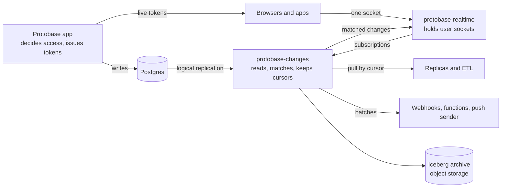

# protobase-changes

Write-efficient Postgres change tracking for live queries, replicas, webhooks and push notifications, with an Iceberg archive for history and analytics.

## Architecture

Postgres writes every committed change to its write-ahead log (WAL) before anything else. Logical replication turns that log into row changes: which table, which key, and the old and new values. A reader follows it through a replication slot, which marks how far the reader got; Postgres keeps the WAL from that point on until the reader confirms it. Reading changes this way is called change data capture (CDC), and it needs no extra writes: no triggers, no outbox table.

protobase-changes is that reader. It runs next to the app and the relay:



- **The app (Protobase)** serves data and issues every token, with its access rules inside. It holds no sockets and no delivery state, so it can sleep.
- **protobase-changes** holds one replication slot per app database, matches conditions against each changed row and keeps cursors. Access is decided in the app, never here.
- **[protobase-realtime](https://github.com/PrototeamHQ/protobase-realtime)**, the relay, holds one connection per user for live queries, notifications, events and presence.

Replicas connect to protobase-changes directly, not through the relay: a backfill would slow every user's live updates, and the relay keeps nothing to replay.

## Design choices

One service reads every change once and serves every way changes leave the database. Each choice below solves a problem that usually needs its own tool.

- **Read the WAL instead of triggers.** Postgres already logs every change, so one replication slot per database replaces outbox tables, triggers and a job row per destination. A write stays one write.
- **The app writes the actor into the WAL.** Who made a change travels as one small logical message per transaction, in the same round trip as the write. No extra table.
- **The app decides access, the service stays simple.** The app turns the user's filter plus the resource's access rule into plain conditions on one row. Subqueries such as "channels I belong to" are resolved when the token is issued, and the app refreshes the subscription when access changes. The service only matches conditions; it never evaluates access rules.
- **Live tokens come with the data.** A list request with `Prefer: live` returns an encrypted token in a header: the conditions, the user and session, and the cursor of the snapshot that was read. Nothing slips between the read and the subscription, and the client can read nothing in the token. Caching stays with the endpoint.
- **One socket per user.** Pages connect only to the relay, which carries live queries, notifications, events and presence. The relay registers each socket's conditions with this service over one connection and routes the matches.
- **Live queries and replication are the same thing.** A replica gets a token with `payload: raw` and no conditions, or a slice such as one tenant. Same matcher, same cursors, same resume.
- **Cursors instead of acknowledgements.** Every message carries a cursor; a consumer that reconnects sends the last one back. No acknowledgement on top of TCP, nothing lost.
- **Each destination has its own cursor.** Webhooks are batched and signed, and a failing receiver waits and retries without holding up the others or skipping anything. At the retry limit it pauses or dead-letters, chosen per destination.
- **Durable without a disk of its own.** The service confirms its place in the slot only after a segment is safely in object storage. Until then Postgres keeps the WAL, so a crash re-reads and loses nothing.
- **The archive is Iceberg.** Every change becomes a row in one Iceberg table per resource, readable by DuckDB, Spark, Trino and ClickHouse. With short retention it is cheap enough for every app, and the same files give record history, an audit log, replay and analytics.
- **Renames survive history.** Schema changes travel in the WAL in order with the rows, and columns keep stable field ids, so old versions read under today's names.
- **Erasure works on an archive.** Personal fields are encrypted per person when archived; deleting that person's key erases them in every copy.
- **Push uses the same stream.** A notification is a row naming its audience. The push sender expands the audience at delivery, skips people who are online, renders once per language, and retracts the push when the row is deleted. Without this service, the app calls the same sender directly.

## Protocols

- **Sockets:** Phoenix V2 frames, so stock Phoenix clients work. Pages use the relay's WebSocket, or SSE where proxies block WebSockets.
- **Pull:** WebSocket, SSE and HTTP long polling, each resuming from `?cursor=`.
- **Events:** CloudEvents in every transport. Webhooks get CloudEvents batches signed with Standard Webhooks.

## A live token

A list or record request opts in with the standard `Prefer` header (RFC 7240). Without that header, the app builds no token at all. The token arrives in a response header, so the body stays plain data and caches and ETags are undisturbed:

```http
GET /api/v1/messages?channel_id=xyz
Prefer: live

HTTP/1.1 200 OK
Preference-Applied: live
Protobase-Live: eyJhbGciOiJkaXIiLCJlbmMiOiJBMjU2R0NNIn0...
Vary: Prefer
```

The token is a JWE, encrypted with AES-256-GCM under a key that the app, the relay and protobase-changes share. The client can read none of it. Decrypted:

```json
{
  "iss": "https://shop.example", "sub": "u42", "sid": "s9", "exp": 1795480000,
  "payload": "thin",
  "cursor": "0/1A2B3C",
  "subs": [ { "resource": "messages",
              "where": { "and": [ { "eq": ["channel_id", "xyz"] },
                                  { "eq": ["tenant_id", "t1"] } ] } } ]
}
```

- `sub` and `sid` bind this token to one user and session. The relay checks them against the socket, along with expiry and revocation, so a copied token is useless.
- `payload` sets the shape of each change: `thin` for live queries, `raw` for the stored rows a replica needs.
- `cursor` marks the snapshot the list was read from, so no change slips between the read and the subscription. Each notice carries a fresh cursor to resume from.
- `where` combines the request's filter, `channel_id`, with the access rule, `tenant_id`. protobase-changes only ever sees plain conditions like these.

Some rules need a subquery, such as "channels I belong to". The app turns the subquery's result into constants when it issues the token. Could that go stale? Yes. When a membership changes, the app calls `live.refresh({ user })`, and the token's expiry caps anything missed.

## Self-hosting

**Development:** `protobase dev` sets it up for you. It downloads protobase-changes, starts it next to your app and the relay, and keeps the archive in `.protobase/changes/` with a short retention.

**Production:** run it next to your app and the relay:

```sh
protobase-changes --config changes.json
```

- **Download:** one binary or container image per GitHub release, like the relay.
- **State:** destination cursors go in a `changes` schema in your app's database.
- **Archive:** any S3-compatible bucket or a local directory.

### Configuration

The config lists every app database to follow; unknown fields stop startup.

```json
{
  "apps": [
    {
      "name": "shop",
      "database_url": "postgres://changes@db.internal/shop",
      "slot": "protobase_changes",
      "publication": "protobase_changes",
      "tail_transactions": 10000
    }
  ]
}
```

- `slot`: the logical replication slot, created with the `pgoutput` plugin on first start and reused after. A slot of that name with another plugin or on another database stops startup; it is never dropped.
- `publication`: must exist before startup.
- Slot and publication names are lowercase letters, digits and underscores, up to 63 characters, not starting with a digit.
- `tail_transactions`: how many of the latest committed transactions stay in memory.
- `archive`: optional, the app's Iceberg archive below. Without it nothing confirms the slot, so Postgres keeps all WAL from the slot's start.

### Archive

Every change becomes one row of an Iceberg table per Postgres table, committed through the app's own Iceberg catalog:

```json
"archive": {
  "catalog": {
    "type": "rest",
    "url": "https://catalog.example/catalog",
    "warehouse": "shop",
    "credential": "client_id:client_secret",
    "properties": { "s3.endpoint": "https://s3.example", "s3.region": "eu-1" }
  },
  "namespace": "shop",
  "segment_bytes": 67108864,
  "segment_seconds": 900,
  "retention_hours": 168
}
```

- `catalog`: an Iceberg REST catalog at `url`, with its `warehouse`, and an OAuth2 client `credential` or a bearer `token` when it needs one. `properties` pass on to the catalog client and its file IO as they are, such as `s3.access-key-id` and `s3.secret-access-key` when the catalog vends no storage credentials. For development, `"type": "sql"` keeps the catalog in a SQLite file at `path` and new tables at `warehouse`, a `file://` folder or an `s3://` bucket path.
- `namespace`: the app's Iceberg namespace. It holds a namespace per Postgres schema, each with a table per Postgres table, such as `shop.public.messages`.
- `segment_bytes`, `segment_seconds`: changes collect in memory until about `segment_bytes` of values or `segment_seconds` have passed since the first, at most 900, then go out as one Parquet file per table.
- `retention_hours`: how long changes and table snapshots are kept.

Each row holds `commit_lsn`, `xid`, `commit_time`, `seq` (the change's position in its transaction), `operation`, `actor` (the transaction's last `protobase_actor` message before the change), `unchanged` (the columns whose large values an update left unchanged and the WAL did not repeat), and three structs with a field per column: `key`, `old` and `new`, each null when the WAL sent no such row. A struct joins the table once a change has columns for it, as Parquet stores no empty struct. Booleans, integers, floats, bytea, dates, times and timestamps keep their types; every other type, such as numeric, uuid or json, is stored in its Postgres text format.

Tables are partitioned by the hour of `commit_time`. Once an hour, every table of the app drops the hours that ended before its retention began, expires the snapshots older than the retention, and merges each finished hour's segment files.

**Schema changes** follow the WAL in order with the rows, and fields keep their Iceberg field ids:

- A new column adds a field. A dropped column keeps its field, null from then on.
- A widening from int to bigint or from real to double precision promotes the field.
- Any other type change moves the old field aside as `<column>__1` (or the next free number), where its values stay readable, and adds a new field.
- A rename keeps the field id when the app announces it in the same transaction as the `ALTER TABLE`, as the WAL alone cannot tell a rename from a drop and an add:

  ```sql
  SELECT pg_logical_emit_message(true, 'protobase_schema',
    '{"rename":{"schema":"public","table":"messages","from":"text","to":"body"}}');
  ```

  Without it, the new name becomes a new field.

**Durability:** a segment commits table by table, each in one catalog commit together with the position it reached, and the slot is confirmed only after every table of the segment committed. After a crash the service reads the unconfirmed changes again, and each table skips what it already holds, so nothing is lost or archived twice. The archive must keep up with the tail: when the tail drops a transaction the archive has not read, the service stops, and the next start reads it again from the slot. <gap>An idle app database holds the server's WAL from its last change because confirming positions past the last transaction is not implemented.</gap> <gap>Personal fields cannot be erased from the archive because per-person encryption is not implemented.</gap>

### Postgres requirements

- `wal_level = logical`, which takes a server restart.
- A role with `REPLICATION` that may connect to the app database.
- A publication of every change of all tables, created once by a superuser:

  ```sql
  CREATE PUBLICATION protobase_changes FOR ALL TABLES;
  ```

  Startup stops when it is missing or skips inserts, updates, deletes or truncates. Once it exists, Postgres refuses UPDATE and DELETE on a table without a primary key or another replica identity.

### Row changes

Each committed transaction arrives once, in commit order, with its id, commit LSN, end LSN, commit time and row changes. A change names its table, operation (insert, update, delete or truncate), key, and the old and new rows as the WAL states them:

- Values keep Postgres' text format, and a null stays distinct from a large value an update left unchanged, which the WAL does not repeat.
- The old row is only the key, and only on a delete or an update that changes the key, unless the table has `REPLICA IDENTITY FULL`; then it is the whole row.
- The key is the primary key or replica identity index. <gap>Tables with REPLICA IDENTITY FULL get no key because a primary key lookup is not implemented.</gap>

A new slot exports a snapshot of the database exactly where its stream starts; when taking it fails, the new slot is dropped so the next start takes it again. <gap>The initial state cannot reach anyone because no consumer of the exported snapshot is implemented.</gap>

The service never confirms its place in the slot by reading: Postgres keeps the WAL until the archive has committed it.

### Logical messages

The app writes transactional logical messages into the WAL, in the same transaction as its rows. Every message whose prefix starts with `protobase_` is attached to its transaction, in order, with its position among the row changes:

```sql
SELECT pg_logical_emit_message(true, 'protobase_actor', '{"sub":"u42","sid":"s9"}');
SELECT pg_logical_emit_message(true, 'protobase_schema', '{"rename":{"schema":"public","table":"messages","from":"text","to":"body"}}');
```

- `protobase_actor`: who made the changes that follow it.
- `protobase_schema`: a schema change, in order with the rows around it, such as the column rename the archive reads.

The content passes on unchanged as bytes; the actor payload above is an example. Messages with other prefixes are skipped. A non-transactional `protobase_` message is skipped with a warning, since it arrives even when its transaction rolls back.

## Running without it

A small app that needs no webhooks, replication or history can skip protobase-changes.

- **Offline for a while:** nothing is lost. The slot holds the WAL up to `max_slot_wal_keep_size`. Webhooks, subscriptions and push catch up when the service returns, and live pages poll meanwhile.
- **Not configured:** reads, writes and the API work as normal, and live pages poll. Push still works: the app calls the push sender directly once the notification row commits.
- **Unavailable without it:** webhooks, event subscriptions, replication and history. `protobase doctor` names what to run. An app that declares them gets a startup warning, not a crash.

An outage that outlasts that WAL limit invalidates the slot. The service rebuilds it, and old cursors get `410` and resync.

## License

Apache-2.0. See [LICENSE](LICENSE).
