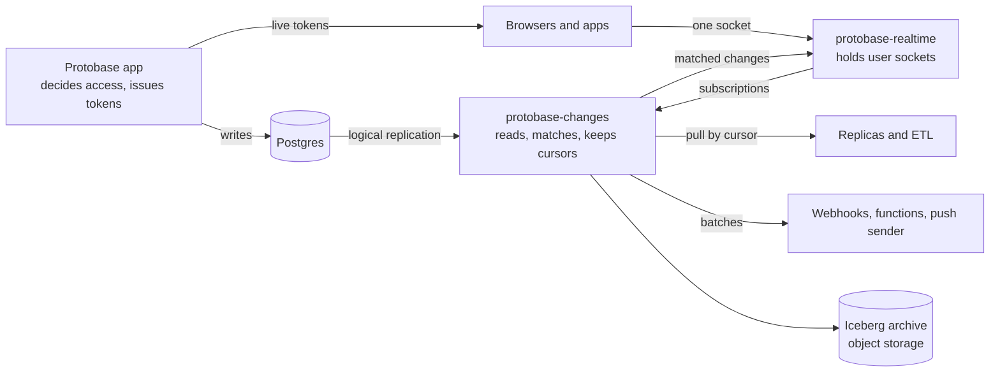

# protobase-changes

Write-efficient Postgres change tracking for live queries, replicas, webhooks and push notifications, with an Iceberg archive for history and analytics.

## Architecture

Postgres writes every committed change to its write-ahead log (WAL) before anything else. Logical replication turns that log into row changes: which table, which key, and the old and new values. A reader follows it through a replication slot, which marks how far the reader got; Postgres keeps the WAL from that point on until the reader confirms it. Reading changes this way is called change data capture (CDC), and it needs no extra writes: no triggers, no outbox table.

protobase-changes is that reader. It runs next to the app and the relay:



- **The app (Protobase)** serves data and issues every token, with its access rules inside. It holds no sockets and no delivery state, so it can sleep.
- **protobase-changes** holds one replication slot per app database, matches conditions against each changed row and keeps cursors. Access is decided in the app, never here.
- **[protobase-realtime](https://github.com/PrototeamHQ/protobase-realtime)**, the relay, holds one connection per user for live queries, notifications, events and presence.

Replicas connect to protobase-changes directly, not through the relay: a backfill would slow every user's live updates, and the relay keeps nothing to replay.

## Design choices

One service reads every change once and serves every way changes leave the database. Each choice below solves a problem that usually needs its own tool.

- **Read the WAL instead of triggers.** Postgres already logs every change, so one replication slot per database replaces outbox tables, triggers and a job row per destination. A write stays one write.
- **The app writes the actor into the WAL.** Who made a change travels as one small logical message per transaction, in the same round trip as the write. No extra table.
- **The app decides access, the service stays simple.** The app turns the user's filter plus the resource's access rule into plain conditions on one row. Subqueries such as "channels I belong to" are resolved when the token is issued, and the app refreshes the subscription when access changes. The service only matches conditions; it never evaluates access rules.
- **Live tokens come with the data.** A list request with `Prefer: live` returns an encrypted token in a header: the conditions, the user and session, and the cursor of the snapshot that was read. Nothing slips between the read and the subscription, and the client can read nothing in the token. Caching stays with the endpoint.
- **One socket per user.** Pages connect only to the relay, which carries live queries, notifications, events and presence. The relay registers each socket's conditions with this service over one connection and routes the matches.
- **Live queries and replication are the same thing.** A replica gets a token with `payload: raw` and no conditions, or a slice such as one tenant. Same matcher, same cursors, same resume.
- **Cursors instead of acknowledgements.** Every message carries a cursor; a consumer that reconnects sends the last one back. No acknowledgement on top of TCP, nothing lost.
- **Each destination has its own cursor.** Webhooks are batched and signed, and a failing receiver waits and retries without holding up the others or skipping anything. At the retry limit it pauses or dead-letters, chosen per destination.
- **Durable without a disk of its own.** The service confirms its place in the slot only after a segment is safely in object storage. Until then Postgres keeps the WAL, so a crash re-reads and loses nothing.
- **The archive is Iceberg.** Every change becomes a row in one Iceberg table per resource, readable by DuckDB, Spark, Trino and ClickHouse. With short retention it is cheap enough for every app, and the same files give record history, an audit log, replay and analytics.
- **Renames survive history.** Schema changes travel in the WAL in order with the rows, and columns keep stable field ids, so old versions read under today's names.
- **Erasure works on an archive.** Personal fields are encrypted per person when archived; deleting that person's key erases them in every copy.
- **Push uses the same stream.** A notification is a row naming its audience. The push sender expands the audience at delivery, skips people who are online, renders once per language, and retracts the push when the row is deleted. Without this service, the app calls the same sender directly.

## Protocols

- **Sockets:** Phoenix V2 frames, so stock Phoenix clients work. Pages use the relay's WebSocket, or SSE where proxies block WebSockets.
- **Pull:** WebSocket, SSE and HTTP long polling, each resuming from `?cursor=`.
- **Events:** CloudEvents in every transport. Webhooks get CloudEvents batches signed with Standard Webhooks.

## A live token

A list or record request opts in with the standard `Prefer` header (RFC 7240). Without that header, the app builds no token at all. The token arrives in a response header, so the body stays plain data and caches and ETags are undisturbed:

```http
GET /api/v1/messages?channel_id=xyz
Prefer: live

HTTP/1.1 200 OK
Preference-Applied: live
Protobase-Live: eyJhbGciOiJkaXIiLCJlbmMiOiJBMjU2R0NNIn0...
Vary: Prefer
```

The token is a JWE, encrypted with AES-256-GCM under a key that the app, the relay and protobase-changes share. The client can read none of it. Decrypted:

```json
{
  "iss": "https://shop.example", "sub": "u42", "sid": "s9", "exp": 1795480000,
  "payload": "thin",
  "cursor": "0/1A2B3C",
  "subs": [ { "resource": "messages",
              "where": { "and": [ { "eq": ["channel_id", "xyz"] },
                                  { "eq": ["tenant_id", "t1"] } ] } } ]
}
```

- `sub` and `sid` bind this token to one user and session. The relay checks them against the socket, along with expiry and revocation, so a copied token is useless.
- `payload` sets the shape of each change: `thin` for live queries, `raw` for the stored rows a replica needs.
- `cursor` marks the snapshot the list was read from, so no change slips between the read and the subscription. Each notice carries a fresh cursor to resume from.
- `where` combines the request's filter, `channel_id`, with the access rule, `tenant_id`. protobase-changes only ever sees plain conditions like these.

Some rules need a subquery, such as "channels I belong to". The app turns the subquery's result into constants when it issues the token. Could that go stale? Yes. When a membership changes, the app calls `live.refresh({ user })`, and the token's expiry caps anything missed.

## Self-hosting

**Development:** `protobase dev` sets it up for you. It downloads protobase-changes, starts it next to your app and the relay, and keeps the archive in `.protobase/changes/` with a short retention.

**Production:** run it next to your app and the relay:

```sh
protobase-changes --database "$DATABASE_URL" --archive s3://my-bucket/changes
```

- **Download:** one binary or container image per GitHub release, like the relay.
- **Postgres:** needs `wal_level = logical` and a role that may create a replication slot.
- **State:** destination cursors go in a `changes` schema in your app's database.
- **Archive:** any S3-compatible bucket or a local directory.

## Running without it

A small app that needs no webhooks, replication or history can skip protobase-changes.

- **Offline for a while:** nothing is lost. The slot holds the WAL up to `max_slot_wal_keep_size`. Webhooks, subscriptions and push catch up when the service returns, and live pages poll meanwhile.
- **Not configured:** reads, writes and the API work as normal, and live pages poll. Push still works: the app calls the push sender directly once the notification row commits.
- **Unavailable without it:** webhooks, event subscriptions, replication and history. `protobase doctor` names what to run. An app that declares them gets a startup warning, not a crash.

An outage that outlasts that WAL limit invalidates the slot. The service rebuilds it, and old cursors get `410` and resync.

## License

Apache-2.0. See [LICENSE](LICENSE).
